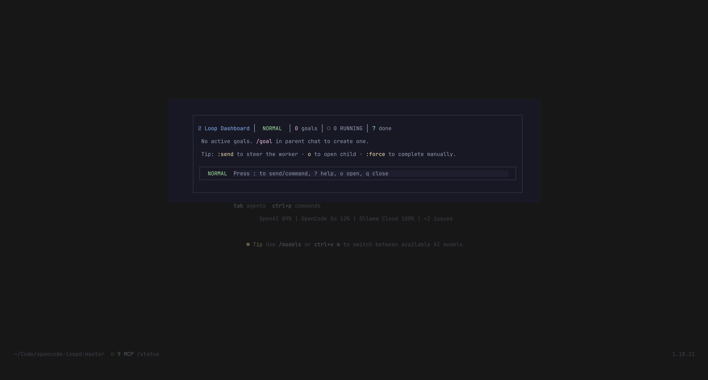
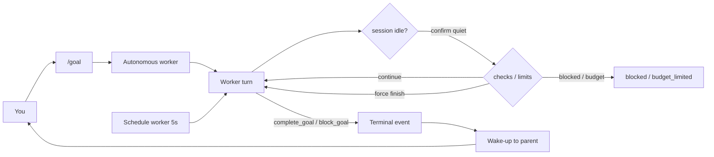

# opencode-loopd

**Give your OpenCode agent a background brain.**

Run long tasks as **autonomous background goals** while you keep chatting. Your agent plans, works, checks its own work, and reports back — no blocked chat, no manual polling.

[](https://www.npmjs.com/package/@bojackduy/opencode-loopd)
[](LICENSE)
[](https://opencode.ai)



*The dashboard (`/loop` or `<leader>o`): goals, status, and a fullscreen terminal. Keys stay inside the dialog — your chat never sees them.*

## What it does

- **Background goals** — say `/goal …` and your agent gets a dedicated worker that keeps going while you do other things.
- **Verified results** — a goal is not "done" until its checks pass. No false "finished" claims.
- **Scheduling** — repeat a goal every hour, every day, or until a condition is met.
- **Safe teamwork** — multiple goals can edit code at the same time when they touch different files.
- **One manager, many projects** — steer goals across several repos from one session.
- **A real dashboard** — vim-style navigation, live status, fullscreen terminal for long commands.

## Install in 60 seconds

### Option A — plugin only

Add to both configs, then restart OpenCode:

```jsonc
// ~/.config/opencode/opencode.jsonc
{ "plugin": ["@bojackduy/opencode-loopd"] }

// ~/.config/opencode/tui.json
{ "plugin": ["@bojackduy/opencode-loopd"] }
```

### Option B — installer (recommended)

```bash
npx -y @bojackduy/opencode-loopd@latest
```

This registers the plugin and installs the `/goal` command. Restart OpenCode when it finishes.

## Your first goal

In any OpenCode session:

```text
/goal fetch the latest AI news and save 10 items to ai-news.md
```

Your agent will clarify the details, start a worker, and keep you posted. Open the dashboard anytime with `/loop` or `<leader>o`.

## How it works



The parent chat stays free. The worker does the work, runs the checks, and wakes you up with a summary when it is done.

## Need the details?

- **Landing page:** https://bojackduy.github.io/opencode-loopd/
- **Technical reference:** [docs/v2-supervisor.md](docs/v2-supervisor.md), [docs/file-scope-ownership.md](docs/file-scope-ownership.md), [docs/management-mode.md](docs/management-mode.md)
- **Lifecycle contract:** [docs/lifecycle-contract.md](docs/lifecycle-contract.md)
- **Issues:** https://github.com/bojackduy/opencode-loopd/issues

## License

AGPL-3.0-or-later — see [LICENSE](./LICENSE).

<!-- SEO: opencode, opencode plugin, background agent, autonomous agent, subagent, goal, loop engine, scheduler, tui, codex, claude code, developer tools, write tickets, concurrency, management mode -->
